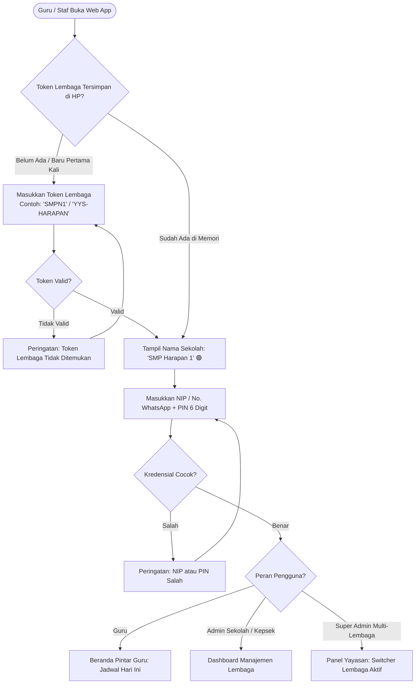
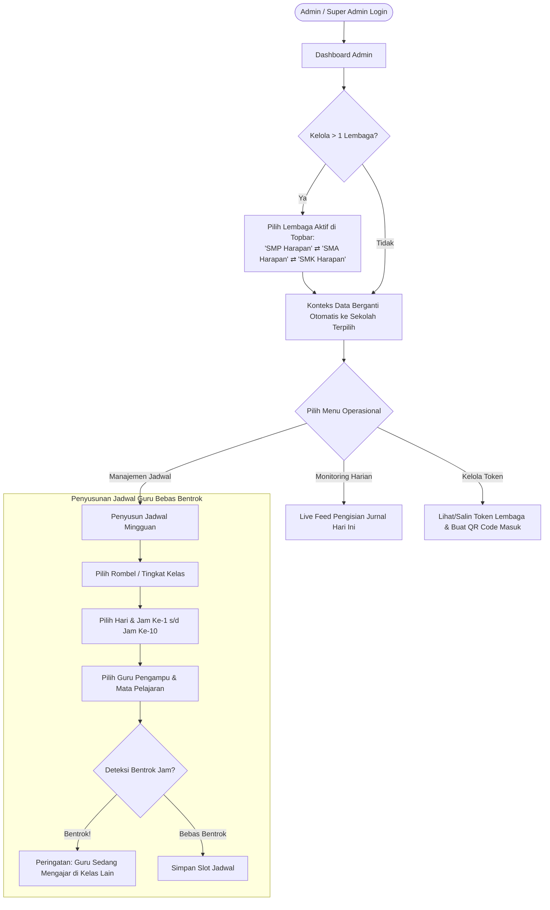
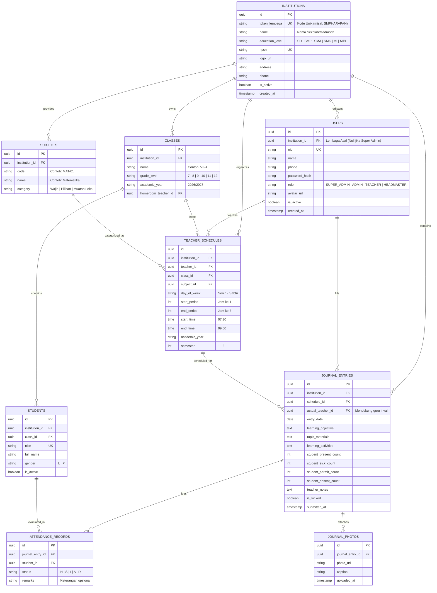

# Product Requirements Document (PRD)
## Web App Jurnal Harian Guru & Presensi Terpadu ("MySch")

---

### 1. Ringkasan Eksekutif (Executive Summary)

**MySch** adalah aplikasi web berbasis *mobile-first* dan *multi-tenant* yang dirancang untuk mempermudah guru dalam mengisi agenda mengajar harian, presensi kehadiran siswa, pencatatan materi ajar, serta catatan kejadian kelas secara cepat dan tanpa ribet.

Aplikasi ini mendukung arsitektur **Multi-Lembaga (Multi-Tenancy)** melalui sistem **Token Lembaga** (Kode Sekolah Unik). Dengan Token Lembaga, seorang Administrator Yayasan / Dinas Pendidikan atau Admin Sekolah dapat mengelola lebih dari satu lembaga pendidikan (misalnya: SMP, SMA, dan SMK dalam satu yayasan) dalam satu platform terpadu, sementara data guru, siswa, kelas, dan jadwal masing-masing lembaga tetap terisolasi secara aman.

Bagi pihak manajemen sekolah (Kepala Sekolah, Wakasek Kurikulum, dan Administrator), aplikasi ini menyediakan panel kendali admin terpadu untuk beralih antar lembaga (*institution switching*), mengelola basis data guru, kelas, mata pelajaran, penyusunan jadwal mengajar mingguan yang dinamis, hingga pemantauan *real-time* kepatuhan pengisian jurnal dan ekspor laporan supervisi resmi.

#### Visi & Misi Produk
* **Visi**: Menghilangkan beban administratif guru di ruang kelas melalui digitalisasi yang manusiawi, efisien, dan ramah bagi guru dari segala tingkatan literasi digital, dengan skalabilitas multi-lembaga yang fleksibel.
* **Misi**:
  1. Memangkas waktu pengisian jurnal dari 15-20 menit (buku fisik) menjadi kurang dari **2 menit** per sesi mengajar.
  2. Meniadakan rekap manual kehadiran dan materi bulanan oleh staf kurikulum.
  3. Memungkinkan pengelolaan terpusat multi-sekolah/lembaga dengan sistem **Token Lembaga** yang aman dan mudah dioperasikan.
  4. Memastikan supervisi pembelajaran sekolah transparan, akuntabel, dan dapat diakses dari perangkat apapun (smartphone, tablet, maupun laptop).

---

### 2. Latar Belakang & Pernyataan Masalah (Problem Statement)

| Masalah Saat Ini (Kondisi Buku Manual / Spreadsheet) | Dampak Negatif | Solusi JurnalGuru |
| :--- | :--- | :--- |
| **Pengelolaan Multi-Sekolah Terpisah-pisah** | Yayasan atau admin yang membawahi beberapa sekolah harus membuat akun/server berbeda untuk tiap unit. | **Sistem Multi-Lembaga & Token Lembaga**: 1 akun Admin dapat mengelola banyak lembaga sekaligus, berganti unit (*switch*) secara instan. |
| **Buku Jurnal Kertas Rentan Rusak & Hilang** | Tulisan tangan tidak terbaca, arsip hilang saat akreditasi atau supervisi dinas. | Penyimpanan berbasis cloud terpusat per lembaga, aman, otomatis ter-backup. |
| **Pengisian Manual Berulang & Membosankan** | Guru harus menulis nama kelas, jam, tanggal, dan mata pelajaran berulang kali setiap hari. | **Auto-detect jadwal harian**: Guru cukup buka aplikasi, sistem langsung menampilkan jadwal kelas yang sedang berlangsung. |
| **Presensi Siswa Menyita Waktu Mengajar** | Memanggil nama siswa satu per satu dari buku absen memakan waktu 10-15 menit. | Konsep **"Default Hadir Semua"**: Guru hanya perlu mengetuk 1-2 siswa yang izin, sakit, atau alpa. |
| **Aplikasi Sekolah Umum Terlalu Rumit** | Banyak aplikasi SIM sekolah sarat form berbelit-belit, lambat di HP jadul, dan membingungkan guru senior. | Desain **Mobile-First & Simple UI**: Ukuran tombol besar, hierarki visual bersih, alur 3 langkah selesai. |
| **Admin Kurikulum Kesulitan Monitor Jadwal** | Sulit mendeteksi guru yang berhalangan hadir atau kelas kosong secara *real-time*. | **Dashboard Supervisi Real-time**: Indikator warna guru yang sudah/belum mengisi jurnal hari ini. |

---

### 3. Profil Pengguna (User Personas) & Matriks Akses (RBAC)

#### 3.1. Persona Pengguna

1. **Pak Joko (54 Tahun) - Guru Senior (Non-Tech Savvy)**
   * *Karakter*: Menggunakan smartphone Android entry-level dengan ukuran font besar. Tidak terbiasa dengan menu navigasi bersarang atau istilah bahasa Inggris teknis.
   * *Kebutuhan*: Buka aplikasi langsung tahu tombol mana yang harus ditekan, token lembaga tersimpan otomatis (atau lewat scan QR code sekolah), dan tidak perlu mengetik panjang di layar sentuh kecil.
   * *Tujuan*: Mengisi jurnal kelas selesai sebelum jam istirahat tanpa bantuan guru muda.

2. **Bu Rina (28 Tahun) - Guru Muda & Wali Kelas**
   * *Karakter*: Cepat dan dinamis, sering menggunakan smartphone sambil berpindah kelas. Mengutamakan kepraktisan dan kecepatan.
   * *Kebutuhan*: Bisa upload 1 foto dokumentasi pembelajaran kelas, mencatat catatan khusus siswa tertentu yang butuh perhatian BK (Bimbingan Konseling).
   * *Tujuan*: Rekap presensi dan materi tercatat rapi otomatis untuk laporan mingguan wali kelas.

3. **Pak Budi (45 Tahun) - Wakasek Kurikulum / Admin Sekolah**
   * *Karakter*: Bekerja dari laptop di kantor kurikulum. Bertanggung jawab atas distribusi jadwal 40+ guru dan 24 rombel kelas di lembaganya.
   * *Kebutuhan*: Fitur input/impor jadwal pelajaran yang fleksibel, deteksi bentrok jam guru, serta ekspor rekapitulasi jurnal mengajar bulanan ke Excel/PDF.
   * *Tujuan*: Memastikan 100% jam pelajaran terisi dan laporan siap diserahkan ke Kepala Sekolah/Pengawas Dinas.

4. **Ibu Hj. Farida (50 Tahun) - Pengurus Yayasan / Super Admin Multi-Lembaga**
   * *Karakter*: Mengawasi 3 unit lembaga di bawah satu yayasan (SMP Harapan, SMA Harapan, dan SMK Harapan).
   * *Kebutuhan*: Dapat mengelola dan memantau ketiga lembaga tersebut dari 1 akun tanpa harus log out dan login berulang kali. Mengeluarkan Token Lembaga untuk masing-masing sekolah.
   * *Tujuan*: Memantau kedisiplinan mengajar seluruh unit sekolah yayasan dalam satu layar dashboard komprehensif.

#### 3.2. Matriks Hak Akses (Role-Based Access Control)

| Modul / Kemampuan | Guru Pengampu | Guru Piket / Inval | Admin Lembaga | Kepala Sekolah | Super Admin Yayasan |
| :--- | :---: | :---: | :---: | :---: | :---: |
| **Login dengan Token Lembaga** | ✅ | ✅ | ✅ | ✅ | ✅ (Bypass/All) |
| **Beralih Antar Lembaga (*Switch Institution*)** | ❌ (1 Sekolah) | ❌ (1 Sekolah) | ❌ (1 Sekolah) | ❌ (1 Sekolah) | ✅ (Semua Lembaga) |
| **Kelola Lembaga & Generate Token Lembaga** | ❌ | ❌ | ❌ | ❌ | ✅ |
| **Lihat Jadwal Mengajar Pribadi** | ✅ | ✅ | ✅ (Semua Guru) | ✅ (Semua Guru) | ✅ (Semua Unit) |
| **Isi Jurnal Hari Berjalan (Presensi, Materi, Catatan)** | ✅ (Jadwal Sendiri) | ✅ (Kelas Pengganti) | ✅ (Bypass) | ❌ (View Only) | ❌ (View Only) |
| **Ubah Jurnal Sendiri (< 24 Jam)** | ✅ | ✅ | ✅ | ❌ | ❌ |
| **Ubah Jurnal Terkunci (> 24 Jam)** | ❌ (Minta Izin) | ❌ | ✅ | ❌ | ✅ |
| **Kelola Master Data (Guru, Siswa, Kelas, Mapel)** | ❌ | ❌ | ✅ | ❌ | ✅ |
| **Kelola & Publikasikan Jadwal Pelajaran** | ❌ | ❌ | ✅ | ❌ | ✅ |
| **Monitoring Dashboard Pengisian Hari Ini** | ❌ | ✅ (Piket) | ✅ | ✅ | ✅ (Multi-Lembaga) |
| **Unduh Rekap Jurnal & Presensi (PDF / Excel)** | ✅ (Kelas Sendiri) | ❌ | ✅ (Per Lembaga) | ✅ (Per Lembaga) | ✅ (Semua Lembaga) |

---

### 4. Alur Kerja Pengguna (User Flows)

#### 4.1. Alur Masuk & Autentikasi dengan Token Lembaga



#### 4.2. Alur Guru: Mengisi Jurnal Harian (Mobile Flow < 2 Menit)

```mermaid
flowchart TD
    Home[Dashboard Beranda Guru - Terikat ke Lembaga Aktif] --> DetectSlot[Sistem Deteksi Otomatis Jadwal Aktif Saat Ini]
    DetectSlot --> CardActive[Kartu: Kelas VIII-A | IPA | Jam 08:45 - 10:15]
    CardActive --> ClickFill[Klik Tombol: 'Mulai Isi Jurnal']
    
    subgraph Wizard [Form Pengisian Jurnal 3-Langkah]
        direction TB
        Step1["Langkah 1: Presensi Siswa\n• Default: Semua Siswa Hadir (32)\n• Ketuk siswa hanya jika Sakit (S), Izin (I), Alpa (A)"]
        Step2["Langkah 2: Materi & Aktivitas\n• Pilih Bab / Capaian Pembelajaran (Dropdown / Pilihan Cepat)\n• Tulis/Pilih Metode (Diskusi, Latihan Soal, Presentasi)"]
        Step3["Langkah 3: Catatan & Dokumentasi\n• Catatan Kejadian / Tindak Lanjut\n• Unggah 1 Foto Suasana Kelas (Otomatis Kompresi)"]
        
        Step1 --> Step2 --> Step3
    end
    
    ClickFill --> Step1
    Step3 --> Submit[Klik 'Simpan Jurnal']
    Submit --> SaveLocal[Simpan Draft & Sinkronisasi ke Server]
    SaveLocal --> Success[Muncul Konfirmasi Berhasil & Centang Hijau]
    Success --> HomeUpdated[Kartu Jadwal Berubah Status: 'Selesai Diisi']
```

#### 4.3. Alur Admin: Pengalihan Lembaga & Penjadwalan Guru



---

### 5. Spesifikasi Kebutuhan Fungsional (Functional Requirements)

#### Modul 0: Multi-Tenancy & Manajemen Token Lembaga
* **FR-0.1**: **Registrasi & Data Lembaga**: Super Admin dapat mendaftarkan lebih dari 1 lembaga pendidikan (nama sekolah, jenjang SD/SMP/SMA/SMK, NPSN, logo sekolah, alamat, dan kontak).
* **FR-0.2**: **Generator Token Lembaga Unik**:
  * Setiap lembaga memiliki satu **Token Lembaga** alfanumerik unik (contoh: `SMPHARAPAN`, `SMA-01`, atau 6 karakter unik seperti `SCH-981`).
  * Token dapat dibuat otomatis oleh sistem atau disesuaikan (*custom token*) oleh admin agar mudah diingat.
  * Opsi *Regenerate Token* jika terjadi kebocoran keamanan.
* **FR-0.3**: **Institution Switcher (Pengalih Lembaga Instan)**:
  * Admin dengan izin multi-lembaga memiliki tombol pengalih lembaga di bagian *navbar/topbar* untuk berpindah konteks kerja antar sekolah dalam 1 klik tanpa harus keluar (*logout*).
  * Seluruh data jadwal, guru, kelas, siswa, dan jurnal otomatis terfilter sesuai lembaga aktif yang dipilih.
* **FR-0.4**: **Kemudahan Akses untuk Guru Awam (Frictionless Onboarding)**:
  * **Penyimpanan Lokal Token**: Setelah guru memasukkan Token Lembaga untuk pertama kali, token disimpan di *LocalStorage / Cookie* perangkat. Pada kunjungan berikutnya, guru langsung melihat nama dan logo sekolahnya dan tidak perlu memasukkan token lagi.
  * **Link Masuk & QR Code Otomatis**: Admin dapat membagikan link langsung via WhatsApp (contoh: `jurnalguru.id/masuk?token=SMPHARAPAN`) atau mencetak poster QR Code di ruang guru. Guru cukup memindai QR Code untuk langsung masuk ke halaman login sekolah tanpa mengetik token manual.

#### Modul 1: Autentikasi & Akun Pengguna
* **FR-1.1**: Autentikasi guru dan staf menggunakan kombinasi: **Token Lembaga** + **NIP/Nomor WhatsApp** + **PIN 6 Angka / Password**.
* **FR-1.2**: Sistem melakukan validasi dinamis (*instant validation*) saat Token Lembaga diketik: menampilkan nama sekolah dan badge terverifikasi sebelum pengguna mengisi NIP/PIN.
* **FR-1.3**: Fitur *"Ingat Saya di Perangkat Ini"* dengan sesi tahan lama (30 hari) agar guru tidak perlu login ulang setiap masuk kelas.
* **FR-1.4**: Admin memiliki hak *Reset PIN/Password* instan jika ada guru yang lupa kredensial.
* **FR-1.5**: Satu guru yang mengajar di 2 lembaga berbeda (misal mengajar di SMP dan SMA dalam yayasan yang sama) dapat ditautkan ke akun yang sama dan memilih sekolah saat login atau beralih akun.
* **FR-1.6**: Profil pengguna memuat: Nama Lengkap, Gelar, NIP/NUPTK, Lembaga Asal, Mata Pelajaran Pokok, Nomor WhatsApp, dan Foto Profil.

#### Modul 2: Beranda Pintar Guru (Smart Daily Dashboard)
* **FR-2.1**: **Kartu Jadwal Aktif Real-time**: Menampilkan jadwal pelajaran yang sesuai dengan hari dan jam sistem saat ini (misal: "Sekarang Sedang Berlangsung: IPA - Kelas 8B, 08:45 - 10:15").
* **FR-2.2**: **Daftar Agenda Hari Ini**: Menampilkan seluruh slot mengajar guru pada hari tersebut dalam bentuk timeline vertikal dengan 3 status:
  * `Belum Diisi` (Abu-abu / Kuning)
  * `Sedang Berlangsung` (Biru Berkedip / Highlight)
  * `Selesai Diisi` (Hijau dengan ikon centang)
* **FR-2.3**: Tombol akses cepat *"Jadwal Hari Lain"* untuk melihat jadwal hari esok atau mengecek riwayat hari sebelumnya.

#### Modul 3: Presensi Siswa Interaktif (Fast Attendance)
* **FR-3.1**: **Logika Default Cerdas**: Saat form dibuka, seluruh siswa di kelas tersebut otomatis berstatus **Hadir (H)**.
* **FR-3.2**: Pengubahan status instan per siswa hanya dengan 1 ketukan pada chip status:
  * `H` (Hadir - Hijau)
  * `S` (Sakit - Kuning/Oranye)
  * `I` (Izin - Biru)
  * `A` (Alpa/Tanpa Keterangan - Merah)
  * `D` (Dispensasi/Tugas Sekolah - Ungu)
* **FR-3.3**: Rekapitulasi angka presensi langsung tampil secara *live* di bagian atas (contoh: *Hadir: 30, Sakit: 1, Izin: 1, Alpa: 0 | Total: 32*).
* **FR-3.4**: Fitur pencarian cepat siswa jika guru ingin langsung menandai nama tertentu tanpa *scroll*.

#### Modul 4: Pengisian Materi & Capaian Pembelajaran
* **FR-4.1**: Pilihan Bab/Materi Pembelajaran terintegrasi dengan silabus/kurikulum sekolah atau input manual cepat.
* **FR-4.2**: **Preset Capaian / Aktivitas Belajar**: Guru dapat memilih satu atau lebih tag aktivitas (misal: *Ceramah Interaktif, Diskusi Kelompok, Praktikum Lab, Ulangan Harian, Tugas Mandiri*) untuk meminimalkan pengetikan.
* **FR-4.3**: Kolom input *Uraian Materi yang Disampaikan* dengan placeholder panduan yang jelas.
* **FR-4.4**: Kolom *Ketercapaian Target*: Pilihan persentase atau slider sederhana (contoh: *100% Selesai*, *75% Sebagian*, *Tunda ke Pertemuan Depan*).

#### Modul 5: Catatan Harian Kelas & Dokumentasi
* **FR-5.1**: Catatan Kejadian Khusus (opsional): Mencatat kejadian penting, seperti siswa yang membutuhkan bimbingan khusus, siswa berprestasi di hari itu, atau insiden di kelas.
* **FR-5.2**: Catatan Sarana & Prasarana: Opsi laporan cepat jika ada fasilitas rusak (contoh: *Proyektor LCD buram*, *AC mati*).
* **FR-5.3**: **Unggah Dokumentasi Kelas**:
  * Mengambil foto langsung dari kamera HP atau galeri.
  * Kompresi otomatis di sisi peramban (client-side) hingga maksimal 300KB untuk menghemat kuota internet guru dan ruang server sekolah.

#### Modul 6: Riwayat & Penguncian Jurnal
* **FR-6.1**: Guru dapat melihat riwayat jurnal terdahulu yang disusun berdasarkan tanggal atau kelas.
* **FR-6.2**: **Batas Waktu Pengeditan**: Jurnal hanya dapat diubah oleh guru dalam kurun waktu 24 jam setelah disimpan. Setelah 24 jam, status terkunci (Read-Only) demi menjaga integritas data presensi dan supervisi.
* **FR-6.3**: Permintaan revisi jurnal terkunci harus diverifikasi dan dibuka kuncinya (*unlocked*) oleh Admin Kurikulum.

#### Modul 7: Panel Admin - Pengelolaan Data Master & Jadwal
* **FR-7.1**: **Master Data**: Kelola Tahun Ajaran aktif, Semester (Ganjil/Genap), Daftar Guru, Daftar Kelas/Rombel, Mata Pelajaran, dan Daftar Siswa (mendukung impor via file template Excel `.xlsx` / `.csv`).
* **FR-7.2**: **Penyusun Jadwal Mingguan (Schedule Matrix Manager)**:
  * Pengaturan jam pelajaran sekolah (Jam ke-0 s/d Jam ke-10 lengkap dengan jam istirahat).
  * Penempatan guru pada mata pelajaran dan kelas tertentu per hari.
  * **Mesin Validasi Bentrok Jadwal**: Memblokir atau memberi peringatan merah jika seorang guru didaftarkan pada 2 kelas yang berbeda di jam yang bersamaan.
* **FR-7.3**: **Fitur Guru Piket / Inval (Guru Pengganti)**:
  * Admin atau Guru Piket dapat mengalihkan jam guru yang berhalangan hadir kepada guru pengganti hanya dengan 2 klik, sehingga guru pengganti bisa mengisi jurnal di akunnya sendiri.

#### Modul 8: Panel Admin - Monitoring Supervisi & Ekspor Laporan
* **FR-8.1**: **Live Attendance & Journal Feed**: Menampilkan matriks harian sekolah, memperlihatkan guru mana saja yang sudah mengajar dan mengisi jurnal, sedang mengajar, atau belum mengisi.
* **FR-8.2**: **Rekapitulasi Kehadiran Siswa**: Menghitung otomatis persentase kehadiran siswa per semester untuk keperluan pengisian rapor.
* **FR-8.3**: **Ekspor Laporan Resmi**:
  * Format PDF (Siap Cetak): Format Buku Agenda Guru berstandar resmi instansi pendidikan lengkap dengan kop sekolah, nama kepala sekolah, tanda tangan, dan NIP.
  * Format Excel (`.xlsx`): Untuk analisis data rekap nilai jam mengajar, keaktifan guru, dan rekap ketidakhadiran siswa.

---

### 6. Kebutuhan Non-Fungsional (Non-Functional Requirements)

1. **Prinsip Mobile-First & Responsif Total**
   * Antarmuka dioptimalkan untuk rasio layar smartphone 9:16 dan 9:20 (layar lebar 360px - 430px) sebagai perangkat utama guru di kelas.
   * Adaptif mulus ke tampilan tablet (768px - 1024px) dan laptop/desktop (>1024px) untuk kebutuhan manajemen jadwal admin.
2. **Performa & Konsumsi Data Rendah**
   * Waktu muat awal (*First Contentful Paint*) < 1.2 detik pada jaringan 4G/3G standar Indonesia.
   * Ukuran bundle JavaScript awal < 150KB (gzipped).
   * Pemanfaatan *Local Storage / IndexedDB Cache* untuk menyimpan draft formulir jika terjadi gangguan sinyal internet di dalam ruang kelas.
3. **Kemudahan untuk Orang Awam (Extreme Usability)**
   * Target sentuh tombol (touch target) minimal 48 x 48 piksel.
   * Ukuran font isi minimal 16 piksel untuk kenyamanan membaca guru senior tanpa kacamata baca.
   * Menggunakan istilah Bahasa Indonesia baku yang lazim di sekolah (contoh: *Jadwal*, *Presensi*, *Mata Pelajaran*, *Rombongan Belajar*).
4. **Keamanan & Integritas Data**
   * Password di-hash menggunakan algoritma modern (bcrypt / Argon2).
   * Token autentikasi disimpan dalam *HTTP-Only Secure Cookie* untuk mencegah eksploitasi XSS.
   * Sanitasi input ketat terhadap materi dan catatan untuk mencegah serangan injeksi.
   * *Audit Log*: Mencatat setiap perubahan jadwal atau jurnal yang dilakukan oleh admin atau guru.

---

### 7. Model Data & Skema Database (ERD Blueprint)



---

### 8. Rencana Implementasi & Roadmap Pengembangan

* **Fase 1 (Core MVP - 2 Minggu)**:
  * Skema database dan modul autentikasi guru & admin.
  * Form presensi kilat (Default Hadir Semua) & Form Materi + Catatan harian.
  * Dashboard Beranda Guru (Mobile-First) dengan deteksi jadwal hari ini.
* **Fase 2 (Manajemen Admin & Penjadwalan - 2 Minggu)**:
  * Impor data master Guru, Kelas, dan Siswa dari Excel.
  * Visual Schedule Matrix Generator untuk menyusun jadwal dan validasi bentrok.
  * Fitur Guru Inval / Pengganti.
* **Fase 3 (Supervisi, Analitik & Pelaporan - 1 Minggu)**:
  * Dashboard real-time keterisian kelas bagi Kepala Sekolah & Wakasek Kurikulum.
  * Generator ekspor rekapitulasi jurnal mengajar resmi (PDF cetak & spreadsheet Excel).
  * PWA (Progressive Web App) dengan dukungan mode offline draft.

---
*Dokumen ini merupakan spesifikasi kebutuhan fungsional resmi untuk memandu implementasi arsitektur perangkat lunak dan rancangan antarmuka pada `design.md`.*
